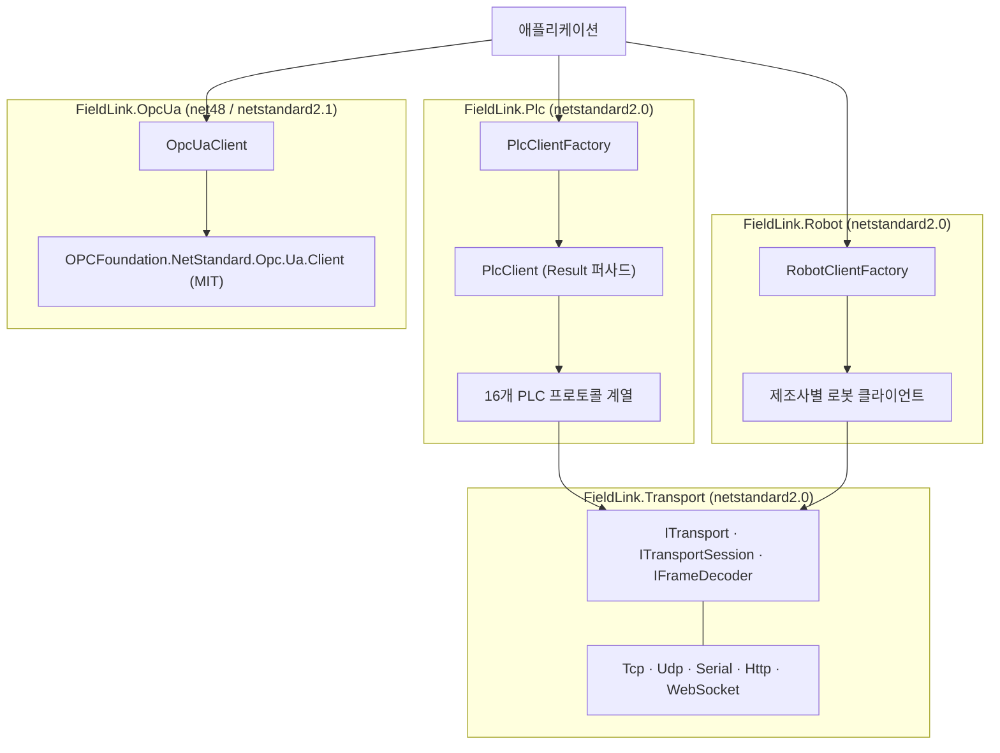

# FieldLink

[English](README.md) | **한국어**

[](LICENSE)
[](Directory.Build.props)
[](src/FieldLink.OpcUa/FieldLink.OpcUa.csproj)
[](Directory.Build.props)

공통 전송 추상화와 클린룸 프로토콜 구현을 기반으로 PLC, 산업용 로봇, OPC UA 서버와 통신하는 .NET 산업용 통신 라이브러리 스위트입니다.

---

## 개요

FieldLink는 바이트 전송, 와이어 프레임 처리, 장치 자료형 변환을 네 개의 독립 패키지로 분리합니다.

| 패키지 | 책임 | 대상 프레임워크 | 주요 진입점 |
| --- | --- | --- | --- |
| [`FieldLink.Transport`](src/FieldLink.Transport/FieldLink.Transport.csproj) | TCP, UDP, Serial(`System.IO.Ports`), HTTP, WebSocket 및 `IFrameDecoder` 프레이밍 | `netstandard2.0` | `ITransport`, `TcpTransport`, `SerialTransport` |
| [`FieldLink.Plc`](src/FieldLink.Plc/FieldLink.Plc.csproj) | 순수 정적 빌더·파서·주소 타입으로 구성된 16종 PLC 프로토콜 제품군 | `netstandard2.0` | [`PlcClientFactory`](src/FieldLink.Plc/PlcClientFactory.cs), [`PlcClient`](src/FieldLink.Plc/PlcClient.cs) |
| [`FieldLink.Robot`](src/FieldLink.Robot/FieldLink.Robot.csproj) | 8개 제조사의 산업용 로봇 컨트롤러 클라이언트 | `netstandard2.0` | [`RobotClientFactory`](src/FieldLink.Robot/RobotClientFactory.cs), [`IRobotClient`](src/FieldLink.Robot/Abstractions/IRobotClient.cs) |
| [`FieldLink.OpcUa`](src/FieldLink.OpcUa/FieldLink.OpcUa.csproj) | 격리된 OPC UA 클라이언트 (`OPCFoundation.NetStandard.Opc.Ua.Client`, MIT) | `net48`, `netstandard2.1` | [`OpcUaClient`](src/FieldLink.OpcUa/OpcUaClient.cs), [`IOpcUaClient`](src/FieldLink.OpcUa/IOpcUaClient.cs) |

### 아키텍처



설계 원칙:

- **계층 격리**: `FieldLink.Transport`는 PLC나 로봇 계층을 참조하지 않습니다. 프로토콜 빌더, 파서, 주소 타입은 상태 없는 순수 함수/불변 타입으로 설계되어 실장비 없이 검증됩니다.
- **명시적 오류 계약**: 호출자 실수(null 입력, 잘못된 주소 형식, `OpenAsync` 이전 호출 등)는 즉시 표준 예외를 발생시킵니다. 현장 I/O 오류와 장치 거부 응답은 `PlcResult` / `PlcResult<T>` 및 `RobotResult` / `RobotResult<T>`로 반환되며, 쓰기 작업은 자동으로 재전송하지 않습니다.
- **OPC UA 의존성 분리**: `FieldLink.OpcUa`는 OPC Foundation 패키지를 코어 전송·PLC·로봇 어셈블리에서 분리하며, 보안 모드는 기본적으로 `MessageSecurityMode.SignAndEncrypt`를 요구하고 무보안 `None`으로 자동 폴백하지 않습니다.

---

## 지원 프로토콜

### PLC 프로토콜 (`FieldLink.Plc`)

| 제조사 / 표준 | 대상 시리즈 | 와이어 프로토콜 및 전송 | `PlcClientFactory` 메서드 |
| --- | --- | --- | --- |
| **Modbus** | 표준 Modbus 장치 | Modbus TCP, Modbus RTU, Modbus ASCII | `CreateModbusTcp`, `CreateModbusRtu`, `CreateModbusAscii` |
| **Mitsubishi Electric** | MELSEC Q / L / iQ-R / iQ-F / FX | MC 프로토콜 3E 프레임 (Binary / ASCII) | `CreateMitsubishiMCBinary`, `CreateMitsubishiMCAscii` |
| **Siemens** | S7-200 / 300 / 400 / 1200 / 1500 | ISO-on-TCP 기반 S7 communication (TPKT + COTP) | `CreateSiemensS7Comm` |
| **LS ELECTRIC** | XGT / XGB / XGK / XGI | FEnet 전용 이더넷 프로토콜 | `CreateLsElectricFEnet` |
| **Delta Electronics** | DVP / AS 시리즈 | 시리즈 주소 매핑 기반 Modbus RTU / TCP | `CreateDelta`, `CreateDeltaDvpRtu`, `CreateDeltaDvpTcp`, `CreateDeltaAsTcp` |
| **FATEK** | FBs 시리즈 | FATEK Serial / TCP ASCII (`STX`/`ETX`/LRC) | `CreateFatek`, `CreateFatekSerial` |
| **Fuji Electric** | SPB Loader / MICREX-SX SPH | SPB ASCII (`:`/`CRLF`) 및 SPH SX-Bus Binary (`0xFB`) | `CreateFujiElectricSpb`, `CreateFujiElectricSpbSerial`, `CreateFujiElectricSph`, `CreateFujiElectricSphTcp` |
| **GE Fanuc / Emerson** | PACSystems RX3i/RX7i, Series 90-30 | TCP 기반 SRTP 56바이트 바이너리 프로토콜 | `CreateGESrtp`, `CreateGESrtpTcp` |
| **Inovance** | AM400/600, H3U, H5U | 시리즈·워드내 비트 매핑 기반 Modbus RTU / TCP | `CreateInovance`, `CreateInovanceTcp`, `CreateInovanceRtu` |
| **JTEKT (Toyota)** | TOYOPUC (2PORT-EFR) | TOYOPUC Computer Link (기본 및 확장 `PRG` 뱅크) | `CreateJtektToyopuc`, `CreateJtektToyopucTcp` |
| **Keyence** | KV-8000 / 7000 / 5000 / 3000 / Nano | KV 상위 링크 ASCII (`CR`/`RDS`/`WRS`/`CQ`) | `CreateKeyenceHostLink`, `CreateKeyenceHostLinkTcp`, `CreateKeyenceHostLinkSerial` |
| **Megmeet** | MC200 / MC280 시리즈 | 16/32비트 카운터 경계 처리 Modbus RTU / TCP | `CreateMegmeet`, `CreateMegmeetRtu`, `CreateMegmeetTcp` |
| **Panasonic** | FP-X / FP0R / FP2SH / FP7 | MEWTOCOL-COM ASCII (`%`/`<` 프레임, BCC) | `CreatePanasonicMewtocol`, `CreatePanasonicMewtocolSerial`, `CreatePanasonicMewtocolTcp` |
| **VIGOR** | VS 시리즈 | Computer Link 바이너리 (`DLE STX ... DLE ETX` + 체크섬) | `CreateVigor`, `CreateVigorSerial` |
| **XINJE** | XC / XD · XL 시리즈 | Modbus RTU / TCP 및 확장 기능 코드 | `CreateXinje`, `CreateXinjeRtu`, `CreateXinjeTcp` |
| **Yokogawa** | FA-M3 시리즈 | Higher-Level Link Service 바이너리 프로토콜 | `CreateYokogawa`, `CreateYokogawaTcp` |

> 모든 팩토리 메서드는 사용자 정의 `ITransport` 주입 오버로드를 제공해 로깅 데코레이터나 모의 전송 테스트를 지원합니다.

### 산업용 로봇 프로토콜 (`FieldLink.Robot`)

| 제조사 | 컨트롤러 / 프로토콜 | 전송 방식 | `RobotClientFactory` 메서드 |
| --- | --- | --- | --- |
| **ABB** | Robot Web Services (RWS) | HTTP / HTTPS | `CreateAbbRws` |
| **EFORT** | ER7B-C10 (V1 / V2 프레임) | TCP | `CreateEfortER7BC10V1`, `CreateEfortER7BC10V2`, `CreateEfortER7BC10` |
| **Estun** | Estun Modbus 인터페이스 | TCP | `CreateEstunModbus` |
| **FANUC** | FANUC Robot Interface | TCP | `CreateFanucRobotInterface` |
| **현대로보틱스 (Hyundai)** | Hi5/Hi6 OnLTrack | UDP 리스너 | `CreateHyundaiOnLTrack` |
| **KUKA** | KUKA VarProxy | TCP | `CreateKukaVarProxy` |
| **KUKA** | KUKA Socket ASCII | TCP | `CreateKukaSocketAscii` |
| **Yamaha** | RCX 컨트롤러 | TCP | `CreateYamahaRcx` |
| **Yaskawa** | YRC Ethernet | TCP | `CreateYaskawaYrcEthernet` |
| **Yaskawa** | High-Speed Ethernet Server (HSE) | UDP | `CreateYaskawaHighSpeedEthernet` |

### OPC UA 클라이언트 (`FieldLink.OpcUa`)

`FieldLink.OpcUa`는 세션 수명주기 관리(`OpenAsync`, `CloseAsync`), 엔드포인트 탐색, X.509 인증서 저장소 구성, 데드라인 강제, 노드 읽기/쓰기(`ReadValueAsync`, `ReadValuesAsync`, `WriteValueAsync`, `WriteValuesAsync`), 주소 공간 탐색(`BrowseAsync`), 모니터링 구독(`SubscribeAsync`), 메서드 호출(`CallAsync`)을 지원합니다. 세부 설정과 보안 기본값은 [OpcUaClientOptions](src/FieldLink.OpcUa/OpcUaClientOptions.cs) 및 [IOpcUaClient](src/FieldLink.OpcUa/IOpcUaClient.cs)에서 확인할 수 있습니다.

---

## 빠른 시작

### PLC 읽기 및 쓰기 (`FieldLink.Plc`)

```csharp
using System;
using System.Threading;
using System.Threading.Tasks;
using FieldLink.Plc;

using var client = PlcClientFactory.CreateMitsubishiMCBinary("192.168.0.10", port: 5000);

PlcResult openResult = await client.OpenAsync(CancellationToken.None);
if (!openResult.IsSuccess)
{
    Console.WriteLine($"연결 실패: {openResult.Error.Message}");
    return;
}

PlcResult<int> counter = await client.ReadInt32Async("D100");
if (counter.IsSuccess)
{
    Console.WriteLine($"D100 = {counter.Value}");
}

PlcResult writeResult = await client.WriteInt16Async("D200", 1234);
if (!writeResult.IsSuccess)
{
    Console.WriteLine($"쓰기 실패: {writeResult.Error.Message}");
}
```

### 산업용 로봇 클라이언트 (`FieldLink.Robot`)

```csharp
using System;
using System.Threading.Tasks;
using FieldLink.Robot;
using FieldLink.Robot.Abstractions;

using var robot = RobotClientFactory.CreateFanucRobotInterface("192.168.0.50");

RobotResult openResult = await robot.OpenAsync();
if (!openResult.IsSuccess)
{
    Console.WriteLine($"로봇 연결 실패: {openResult.Error.Message}");
    return;
}

RobotResult<string> response = await robot.ReadStringAsync("snapshot");
if (response.IsSuccess)
{
    Console.WriteLine(response.Value);
}
```

### OPC UA 클라이언트 (`FieldLink.OpcUa`)

```csharp
using System;
using System.Threading;
using System.Threading.Tasks;
using FieldLink.OpcUa;
using FieldLink.OpcUa.Security;
using Opc.Ua;

var options = new OpcUaClientOptions
{
    EndpointUrl = new Uri("opc.tcp://127.0.0.1:4840"),
    ApplicationName = "PlantClient",
    ApplicationUri = "urn:example:plant:client",
    MessageSecurityMode = MessageSecurityMode.SignAndEncrypt,
    UserIdentity = OpcUaUserIdentity.CreateAnonymous(),
    Certificates = new OpcUaCertificateOptions
    {
        StoreType = OpcUaCertificateStoreType.Directory,
        ApplicationCertificateStorePath = "pki/own",
        TrustedPeerCertificatesStorePath = "pki/trusted",
        TrustedIssuerCertificatesStorePath = "pki/issuer",
        RejectedCertificateStorePath = "pki/rejected"
    }
};

await using var opcClient = new OpcUaClient(options);
await opcClient.OpenAsync(CancellationToken.None);

DataValue value = await opcClient.ReadValueAsync(
    new ExpandedNodeId("TestRoot.Scalar.Int32", "urn:example:server"));
Console.WriteLine($"Value = {value.Value}, Status = {value.StatusCode}");
```

---

## 빌드 및 테스트

저장소는 `.slnx` 솔루션, 중앙 패키지 관리([Directory.Packages.props](Directory.Packages.props)), 엄격한 분석기([Directory.Build.props](Directory.Build.props)), 통일된 `.editorconfig` 규칙을 사용합니다.

```powershell
# 전체 라이브러리·테스트·도구 빌드 (경고를 오류로 처리)
dotnet build FieldLink.slnx -c Release

# 단위 테스트 및 루프백 통합 테스트 실행
dotnet test FieldLink.slnx -c Release

# 코드 포맷 및 스타일 준수 여부 검증
dotnet format FieldLink.slnx --verify-no-changes
```

> **참고**: `[Trait("Category", "Hardware")]` 특성이 붙은 실장비 테스트는 물리 장치가 필요하므로 기본 테스트 실행에서 제외됩니다.

---

## 저장소 구조

```text
FieldLink/
├─ FieldLink.slnx
├─ Directory.Build.props          공통 빌드 설정 (Nullable, C# 12, 경고=오류)
├─ Directory.Packages.props       NuGet 패키지 버전 중앙 관리
├─ LICENSE                        MIT 라이선스
├─ README.md                      영문 문서
├─ README.ko.md                   국문 문서
├─ THIRD-PARTY-NOTICES.md         서드파티 라이선스 고지
├─ src/
│  ├─ FieldLink.Transport/        핵심 전송 및 프레이밍 추상화
│  ├─ FieldLink.Plc/              PLC 클라이언트 퍼사드 및 16개 프로토콜 구현
│  ├─ FieldLink.Robot/            산업용 로봇 컨트롤러 프로토콜
│  ├─ FieldLink.OpcUa/            격리된 OPC UA 클라이언트 래퍼
│  └─ Shared/Polyfills/           netstandard2.0용 컴파일러 폴리필
├─ tests/
│  ├─ FieldLink.Transport.Tests/
│  ├─ FieldLink.Plc.Tests/
│  ├─ FieldLink.Robot.Tests/
│  └─ FieldLink.OpcUa.Tests/
└─ tools/
   └─ FieldLink.PacketBench/      패킷 벤치마크 유틸리티
```

---

## 클린룸 정책 및 라이선스

FieldLink는 **클린룸 아키텍처**를 따릅니다. PLC 및 로봇 와이어 코덱은 외부 드라이버 구현을 복제하지 않고 제조사 공식 매뉴얼, 공개 표준 문서, 실장비 동작만을 근거로 구현합니다.

- **라이선스**: [MIT License](LICENSE)
- **서드파티 고지**: [THIRD-PARTY-NOTICES.md](THIRD-PARTY-NOTICES.md)
