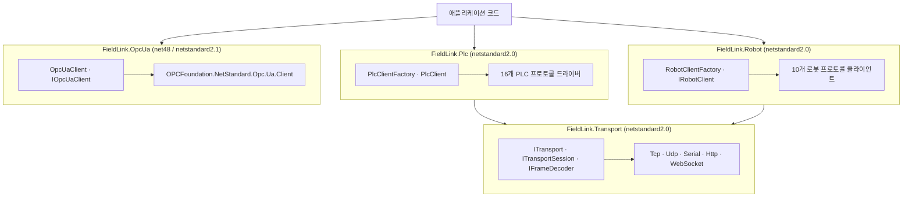

<div align="center">

# FieldLink

**통합 .NET 산업용 통신 라이브러리 스위트**  
PLC 프로토콜 · 산업용 로봇 · OPC UA (IEC 62541) · 전송 및 프레이밍

[English](README.md) | **한국어**

[](LICENSE)
[](Directory.Build.props)
[](src/FieldLink.OpcUa/FieldLink.OpcUa.csproj)
[](Directory.Build.props)

[핵심 설계](#핵심-설계) · [아키텍처](#아키텍처) · [지원 프로토콜](#지원-프로토콜) · [빠른 시작](#빠른-시작) · [빌드 및 테스트](#빌드-및-테스트) · [라이선스](#라이선스)

</div>

---

## 핵심 설계

- **엄격한 계층 분리**: [`FieldLink.Transport`](src/FieldLink.Transport/FieldLink.Transport.csproj)는 바이트 스트림, 데이터그램, 프레임 경계만 다루며 PLC나 로봇 계층을 참조하지 않습니다. 장치 라이브러리는 전송 계약 인터페이스를 통해서만 통신합니다.
- **상태 없는 와이어 코덱**: 프로토콜별 `*Address`, `*RequestBuilder`, `*ResponseParser`, `*FrameDecoder`는 상태 없는 순수 타입으로 설계되어 실장비 없이 패킷 단위로 결정적 검증이 가능합니다.
- **명시적 오류 및 진행 계약**: 잘못된 인수, 주소 형식 오류, `OpenAsync` 이전 호출 등 호출자 실수는 즉시 표준 예외를 발생시킵니다. I/O 장애나 장치 거부 응답은 [`PlcResult`](src/FieldLink.Plc/PlcResult.cs) / `RobotResult`로 반환하며 분할 쓰기 시 부분 완료 수(`CompletedCount`)를 기록하고 쓰기를 임의로 재전송하지 않습니다.
- **OPC UA 스택 격리**: [`FieldLink.OpcUa`](src/FieldLink.OpcUa/FieldLink.OpcUa.csproj)는 `OPCFoundation.NetStandard.Opc.Ua.Client` 의존성을 코어 패키지와 분리하며, 기본적으로 `MessageSecurityMode.SignAndEncrypt`를 강제하고 무보안 통신으로 자동 전환하지 않습니다.

---

## 아키텍처

| 패키지 | 대상 프레임워크 | 역할 및 주요 진입점 |
| --- | --- | --- |
| [`FieldLink.Transport`](src/FieldLink.Transport/FieldLink.Transport.csproj) | `netstandard2.0` | TCP·UDP·Serial·HTTP·WebSocket 전송 및 `IFrameDecoder` 코덱 ([`ITransport`](src/FieldLink.Transport/ITransport.cs)) |
| [`FieldLink.Plc`](src/FieldLink.Plc/FieldLink.Plc.csproj) | `netstandard2.0` | 16개 PLC 프로토콜 통합 읽기/쓰기 퍼사드 ([`PlcClientFactory`](src/FieldLink.Plc/PlcClientFactory.cs), [`PlcClient`](src/FieldLink.Plc/PlcClient.cs)) |
| [`FieldLink.Robot`](src/FieldLink.Robot/FieldLink.Robot.csproj) | `netstandard2.0` | 8개 제조사 산업용 로봇 컨트롤러 클라이언트 ([`RobotClientFactory`](src/FieldLink.Robot/RobotClientFactory.cs), [`IRobotClient`](src/FieldLink.Robot/Abstractions/IRobotClient.cs)) |
| [`FieldLink.OpcUa`](src/FieldLink.OpcUa/FieldLink.OpcUa.csproj) | `net48`, `netstandard2.1` | 보안 정책 강제 OPC UA (IEC 62541) 래퍼 ([`OpcUaClient`](src/FieldLink.OpcUa/OpcUaClient.cs), [`IOpcUaClient`](src/FieldLink.OpcUa/IOpcUaClient.cs)) |



---

## 지원 프로토콜

### PLC 프로토콜 (`FieldLink.Plc`)

> [!NOTE]
> 모든 PLC 팩토리 메서드는 사용자 정의 `ITransport` 주입 오버로드(`Create...(ITransport, ...)`)도 함께 제공하므로 로깅 데코레이터나 단위 테스트용 모의 전송을 그대로 연결할 수 있습니다.

#### 이더넷 · 표준 프로토콜

| 제조사 · 대상 시리즈 | 프로토콜 및 프레이밍 | `PlcClientFactory` 진입점 |
| --- | --- | --- |
| **Modbus**<br>표준 Modbus 장치 | Modbus TCP · RTU · ASCII | `CreateModbusTcp`<br>`CreateModbusRtu`<br>`CreateModbusAscii` |
| **Mitsubishi Electric**<br>Q / L / iQ-R / iQ-F / FX | MC 3E/4E (Binary·ASCII, TCP/UDP) | `CreateMitsubishiMCBinaryTcp`<br>`CreateMitsubishiMCBinaryUdp`<br>`CreateMitsubishiMCAsciiTcp`<br>`CreateMitsubishiMCAsciiUdp` |
| **LS ELECTRIC**<br>XGT / XGB / XGK / XGI | FEnet 전용 이더넷 (TCP) | `CreateLsElectricFEnet` |
| **Siemens**<br>S7-200/300/400/1200/1500 | ISO-on-TCP 기반 S7comm | `CreateSiemensS7Comm` |
| **GE Fanuc / Emerson**<br>RX3i / RX7i / 90-30 | SRTP 56바이트 바이너리 (TCP) | `CreateGESrtpTcp` |
| **Fuji Electric**<br>MICREX-SX SPH | SPH SX-Bus 바이너리 (TCP) | `CreateFujiElectricSphTcp` |
| **JTEKT (Toyota)**<br>TOYOPUC (2PORT-EFR) | TOYOPUC Computer Link (TCP) | `CreateJtektToyopucTcp` |
| **Yokogawa**<br>FA-M3 시리즈 | Higher-Level Link 바이너리 (TCP) | `CreateYokogawaTcp` |

#### 시리얼 · 상위 링크 프로토콜

| 제조사 · 대상 시리즈 | 프로토콜 및 프레이밍 | `PlcClientFactory` 진입점 |
| --- | --- | --- |
| **Keyence**<br>KV-8000/7000/5000/3000/Nano | KV 상위 링크 ASCII (TCP / Serial) | `CreateKeyenceHostLinkTcp`<br>`CreateKeyenceHostLinkSerial` |
| **Panasonic**<br>FP-X / FP0R / FP2SH / FP7 | MEWTOCOL-COM ASCII (TCP / Serial) | `CreatePanasonicMewtocolTcp`<br>`CreatePanasonicMewtocolSerial` |
| **Fuji Electric**<br>MICREX-F SPB Loader | SPB ASCII (Serial) | `CreateFujiElectricSpbSerial` |
| **FATEK**<br>FBs 시리즈 | FATEK ASCII `STX`/`ETX` (Serial) | `CreateFatekSerial` |
| **VIGOR**<br>VS 시리즈 | Computer Link 바이너리 (Serial) | `CreateVigorSerial` |

#### Modbus 매핑 기반 PLC 제품군

| 제조사 · 대상 시리즈 | 프로토콜 및 매핑 | `PlcClientFactory` 진입점 |
| --- | --- | --- |
| **Delta Electronics**<br>DVP / AS 시리즈 | Modbus TCP / RTU + 시리즈 주소 매핑 | `CreateDeltaDvpTcp`<br>`CreateDeltaAsTcp`<br>`CreateDeltaDvpRtu` |
| **Inovance**<br>AM400/600, H3U, H5U | Modbus TCP / RTU + 워드 내 비트 매핑 | `CreateInovanceTcp`<br>`CreateInovanceRtu` |
| **XINJE**<br>XC / XD · XL 시리즈 | Modbus TCP / RTU + 확장 기능 코드 | `CreateXinjeTcp`<br>`CreateXinjeRtu` |
| **Megmeet**<br>MC200 / MC280 시리즈 | Modbus TCP / RTU + 32비트 카운터 경계 | `CreateMegmeetTcp`<br>`CreateMegmeetRtu` |

### 산업용 로봇 프로토콜 (`FieldLink.Robot`)

| 제조사 · 컨트롤러 | 프로토콜 및 전송 방식 | `RobotClientFactory` 진입점 |
| --- | --- | --- |
| **ABB** (IRC5 / OmniCore) | Robot Web Services (HTTP / HTTPS) | `CreateAbbRws` |
| **EFORT** (ER7B-C10 V1 / V2) | EFORT 바이너리 (TCP) | `CreateEfortER7BC10V2`<br>`CreateEfortER7BC10V1` |
| **Estun** | Estun Modbus 인터페이스 (TCP) | `CreateEstunModbus` |
| **FANUC** | FANUC Robot Interface (TCP) | `CreateFanucRobotInterface` |
| **현대로보틱스 (Hyundai)** (Hi5 / Hi6) | OnLTrack (UDP 리스너) | `CreateHyundaiOnLTrack` |
| **KUKA** | VarProxy · Socket ASCII (TCP) | `CreateKukaVarProxy`<br>`CreateKukaSocketAscii` |
| **Yamaha** (RCX) | RCX 컨트롤러 ASCII (TCP) | `CreateYamahaRcx` |
| **Yaskawa** (YRC1000 / DX200) | YRC Ethernet (TCP) · HSE (UDP) | `CreateYaskawaYrcEthernet`<br>`CreateYaskawaHighSpeedEthernet` |

### OPC UA 및 전송 계층

- **OPC UA (`FieldLink.OpcUa`)**:
  - **세션 수명주기 및 탐색**: Endpoint 탐색(`OpcUaSdkDiscoveryClient`), 엄격한 X.509 인증서 신뢰 검증(미신뢰 인증서 자동 승인 금지), 도메인 검증(`checkDomain: true`), 세대 격리 세션 관리
  - **데이터 접근 및 서비스**: 단건·일괄 읽기/쓰기(`ReadValueAsync`, `ReadValuesAsync`, `WriteValueAsync`, `WriteValuesAsync`), 주소 공간 탐색(`BrowseAsync`), 메서드 호출(`CallAsync`) 및 `OpcUaDeadline` 전체 타임아웃 제어
  - **구독**: 유한 큐 기반 백프레셔 제어를 제공하는 모니터링 구독(`SubscribeAsync`)
- **전송 및 프레이밍 (`FieldLink.Transport`)**:
  - **채널**: `TcpTransport`, `UdpTransport`, `UdpListenerTransport`, `SerialTransport`, `HttpTransport`, `WebSocketTransport`
  - **프레임 디코더 (`IFrameDecoder`)**: `FixedLengthFrameDecoder`, `DelimitedFrameDecoder`, `HeaderLengthFrameDecoder`, `AvailableBytesFrameDecoder`

---

## 빠른 시작

### 1. PLC 클라이언트 (`FieldLink.Plc`)

#### 1-1. 전송 방식 선택 (TCP vs UDP) 및 단건 읽기/쓰기

```csharp
using System;
using System.Threading;
using System.Threading.Tasks;
using FieldLink.Plc;

// PlcClientFactory 메서드 이름으로 TCP / UDP를 명시적으로 선택합니다 (기본 포트: 5000)
using var client = PlcClientFactory.CreateMitsubishiMCBinaryTcp("192.168.0.10", port: 5000);

// UDP를 사용할 때는 아래와 같이 호출합니다 (필요 시 localPort로 PC 측 바인딩 포트 지정 가능)
// using var client = PlcClientFactory.CreateMitsubishiMCBinaryUdp("192.168.0.10", port: 5000);

PlcResult openResult = await client.OpenAsync(CancellationToken.None);
if (!openResult.IsSuccess)
{
    Console.WriteLine($"연결 실패: {openResult.Error.Message}");
    return;
}

PlcResult<int> counter = await client.ReadInt32Async("D100");
if (counter.IsSuccess)
{
    Console.WriteLine($"D100 = {counter.Value}");
}

PlcResult writeResult = await client.WriteInt16Async("D200", 1234);
if (!writeResult.IsSuccess)
{
    Console.WriteLine($"쓰기 실패: {writeResult.Error.Message}");
}
```

#### 1-2. 연속 쓰기 · 연속 읽기 (배열, 비트, 문자열, 대량 분할 쓰기)

`Write*Async` 메서드에 배열을 전달하면 시작 주소부터 연속된 레지스터·비트에 일괄 기록합니다. 프로토콜 1회 최대 한도(예: MC 3E 기본 960워드)를 넘기면 내부에서 자동으로 청크를 나누어 순차 전송합니다.

```csharp
// 1. 연속 16비트 워드 배열 쓰기 및 읽기 (D100 ~ D103)
PlcResult wordWrite = await client.WriteInt16Async("D100", new short[] { 10, 20, 30, 40 });
PlcResult<short[]> wordRead = await client.ReadInt16Async("D100", count: 4);

// 2. 연속 32비트 정수 · 단정밀도 실수 배열 쓰기 (D200 ~ D203, D300 ~ D305)
await client.WriteInt32Async("D200", new int[] { 100_000, 200_000 });
await client.WriteSingleAsync("D300", new float[] { 12.5f, 37.25f, 99.0f });

// 3. 연속 비트 배열 쓰기 및 읽기 (M100 ~ M103)
await client.WriteBooleanAsync("M100", new bool[] { true, false, true, true });
PlcResult<bool[]> bitRead = await client.ReadBooleanAsync("M100", count: 4);

// 4. 연속 워드 영역에 문자열 쓰기 및 읽기 (D400 ~ D407, 16바이트 용량)
await client.WriteStringAsync("D400", "LOT-2026A", characterCapacity: 16);
PlcResult<string> lotCode = await client.ReadStringAsync("D400", characterCapacity: 16);

// 5. 한도를 초과하는 대량 연속 쓰기 (자동 분할 및 실패 시 완료 개수 확인)
short[] recipe = new short[2000];
PlcResult bulkWrite = await client.WriteInt16Async("D1000", recipe);
if (!bulkWrite.IsSuccess)
{
    Console.WriteLine(
        $"대량 쓰기 실패: {bulkWrite.Error.Message} (완료된 원소 수: {bulkWrite.Error.CompletedCount})");
}
```

### 2. 산업용 로봇 클라이언트 (`FieldLink.Robot`)

```csharp
using System;
using System.Threading.Tasks;
using FieldLink.Robot;
using FieldLink.Robot.Abstractions;

using var robot = RobotClientFactory.CreateFanucRobotInterface("192.168.0.50");

RobotResult openResult = await robot.OpenAsync();
if (!openResult.IsSuccess)
{
    Console.WriteLine($"로봇 연결 실패: {openResult.Error.Message}");
    return;
}

RobotResult<string> snapshot = await robot.ReadStringAsync("snapshot");
if (snapshot.IsSuccess)
{
    Console.WriteLine(snapshot.Value);
}
```

### 3. OPC UA 클라이언트 (`FieldLink.OpcUa`)

```csharp
using System;
using System.Threading;
using System.Threading.Tasks;
using FieldLink.OpcUa;
using FieldLink.OpcUa.Security;
using Opc.Ua;

var options = new OpcUaClientOptions
{
    EndpointUrl = new Uri("opc.tcp://127.0.0.1:4840"),
    ApplicationName = "PlantClient",
    ApplicationUri = "urn:example:plant:client",
    MessageSecurityMode = MessageSecurityMode.SignAndEncrypt,
    UserIdentity = OpcUaUserIdentity.CreateAnonymous(),
    Certificates = new OpcUaCertificateOptions
    {
        StoreType = OpcUaCertificateStoreType.Directory,
        ApplicationCertificateStorePath = "pki/own",
        TrustedPeerCertificatesStorePath = "pki/trusted",
        TrustedIssuerCertificatesStorePath = "pki/issuer",
        RejectedCertificateStorePath = "pki/rejected"
    }
};

await using var opcClient = new OpcUaClient(options);
await opcClient.OpenAsync(CancellationToken.None);

DataValue value = await opcClient.ReadValueAsync(
    new ExpandedNodeId("TestRoot.Scalar.Int32", "urn:example:server"));
Console.WriteLine($"Value = {value.Value}, Status = {value.StatusCode}");
```

---

## 빌드 및 테스트

저장소는 [`FieldLink.slnx`](FieldLink.slnx) 솔루션, 중앙 패키지 관리([`Directory.Packages.props`](Directory.Packages.props)), 경고를 오류로 취급하는 엄격한 빌드·스타일 규칙([`Directory.Build.props`](Directory.Build.props), [`.editorconfig`](.editorconfig))을 사용합니다.

```powershell
# 전체 라이브러리·테스트·도구 빌드
dotnet build FieldLink.slnx -c Release

# 단위 및 로컬 루프백 통합 테스트 실행
dotnet test FieldLink.slnx -c Release

# 포맷 및 코드 스타일 준수 검증
dotnet format FieldLink.slnx --verify-no-changes
```

- **`FieldLink.Transport.Tests`** (`net8.0`): 프레임 디코더, 스트림 세션, TCP/UDP/Serial 수명주기
- **`FieldLink.Plc.Tests`** (`net8.0`): 주소 파서, 요청 빌더, 응답 파서, 다중 분할 프로토콜 상태
- **`FieldLink.Robot.Tests`** (`net8.0`): 로봇 프로토콜 코덱, HTTP/TCP/UDP 드라이버, 세션 초기화
- **`FieldLink.OpcUa.Tests`** (`net10.0`, `net48`): 루프백 OPC UA 서버 연동, 보안 정책 검증, 구독 처리

> `[Trait("Category", "Hardware")]` 특성이 붙은 실장비 통합 테스트는 물리 장치가 필요하므로 오프라인 자동 테스트에서 제외됩니다.

---

## 저장소 구조

```text
FieldLink/
├─ FieldLink.slnx                 솔루션 정의
├─ Directory.Build.props          공통 MSBuild 속성 (Nullable, C# 12, WarningsAsErrors)
├─ Directory.Packages.props       NuGet 패키지 버전 중앙 관리
├─ .editorconfig                  코드 스타일 및 분석기 규칙
├─ LICENSE                        MIT 라이선스
├─ README.md                      영문 문서
├─ README.ko.md                   국문 문서
├─ THIRD-PARTY-NOTICES.md         서드파티 라이선스 고지
├─ src/
│  ├─ FieldLink.Transport/        전송 채널 및 IFrameDecoder 코덱
│  ├─ FieldLink.Plc/              PLC 클라이언트 퍼사드 및 16개 프로토콜 구현
│  ├─ FieldLink.Robot/            산업용 로봇 프로토콜 클라이언트
│  ├─ FieldLink.OpcUa/            격리된 OPC UA (IEC 62541) 클라이언트 래퍼
│  └─ Shared/Polyfills/           netstandard2.0용 컴파일러 폴리필
├─ tests/
│  ├─ FieldLink.Transport.Tests/
│  ├─ FieldLink.Plc.Tests/
│  ├─ FieldLink.Robot.Tests/
│  └─ FieldLink.OpcUa.Tests/
└─ tools/
   └─ FieldLink.PacketBench/      패킷 처리량 및 할당 벤치마크 도구
```

---

## 라이선스

- **프로젝트 라이선스**: [MIT License](LICENSE)
- **서드파티 고지**: [THIRD-PARTY-NOTICES.md](THIRD-PARTY-NOTICES.md)
