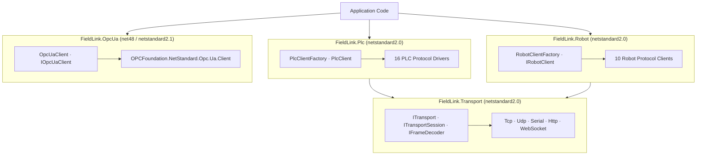

<div align="center">

# FieldLink

**Unified Industrial Communication Suite for .NET**  
PLC Protocols · Industrial Robots · OPC UA (IEC 62541) · Transport & Framing

**English** | [한국어](README.ko.md)

[](LICENSE)
[](Directory.Build.props)
[](src/FieldLink.OpcUa/FieldLink.OpcUa.csproj)
[](Directory.Build.props)

[Highlights](#highlights) · [Architecture](#architecture) · [Supported Protocols](#supported-protocols) · [Quick Start](#quick-start) · [Build and Test](#build-and-test) · [License](#license)

</div>

---

## Highlights

- **Strict Layer Separation**: [`FieldLink.Transport`](src/FieldLink.Transport/FieldLink.Transport.csproj) operates purely on byte streams, datagrams, and message frames with zero knowledge of PLC or robot semantics. Device packages communicate exclusively through transport contracts.
- **Stateless Wire Codecs**: Protocol `*Address`, `*RequestBuilder`, `*ResponseParser`, and `*FrameDecoder` types are stateless and hardware-independent, enabling deterministic frame-level verification without physical hardware.
- **Explicit Failure & Progress Contract**: Caller mistakes (null arguments, invalid addresses, calls before `OpenAsync`) fail fast with standard .NET exceptions. Operational I/O errors and device rejections return [`PlcResult`](src/FieldLink.Plc/PlcResult.cs) / `RobotResult`—tracking partial completion counts (`CompletedCount`) on multi-chunk writes and never retrying writes implicitly.
- **Isolated OPC UA Stack**: [`FieldLink.OpcUa`](src/FieldLink.OpcUa/FieldLink.OpcUa.csproj) isolates `OPCFoundation.NetStandard.Opc.Ua.Client` from core packages and enforces `MessageSecurityMode.SignAndEncrypt` by default without silent fallback to unencrypted connections.

---

## Architecture

| Package | Target | Role & Entry Point |
| --- | --- | --- |
| [`FieldLink.Transport`](src/FieldLink.Transport/FieldLink.Transport.csproj) | `netstandard2.0` | TCP, UDP, Serial, HTTP, WebSocket channels & `IFrameDecoder` codecs ([`ITransport`](src/FieldLink.Transport/ITransport.cs)) |
| [`FieldLink.Plc`](src/FieldLink.Plc/FieldLink.Plc.csproj) | `netstandard2.0` | 16 PLC protocol families with unified typed read/write facade ([`PlcClientFactory`](src/FieldLink.Plc/PlcClientFactory.cs), [`PlcClient`](src/FieldLink.Plc/PlcClient.cs)) |
| [`FieldLink.Robot`](src/FieldLink.Robot/FieldLink.Robot.csproj) | `netstandard2.0` | Industrial robot controller clients across 8 OEMs ([`RobotClientFactory`](src/FieldLink.Robot/RobotClientFactory.cs), [`IRobotClient`](src/FieldLink.Robot/Abstractions/IRobotClient.cs)) |
| [`FieldLink.OpcUa`](src/FieldLink.OpcUa/FieldLink.OpcUa.csproj) | `net48`, `netstandard2.1` | Security-enforced OPC UA (IEC 62541) wrapper ([`OpcUaClient`](src/FieldLink.OpcUa/OpcUaClient.cs), [`IOpcUaClient`](src/FieldLink.OpcUa/IOpcUaClient.cs)) |



---

## Supported Protocols

### PLC Protocols (`FieldLink.Plc`)

> [!NOTE]
> Every PLC factory method group also includes a `Create...(ITransport, ...)` overload for custom transports, packet-recording decorators, and offline unit tests.

#### Ethernet & Standard Protocols

| Vendor & Series | Protocol & Framing | `PlcClientFactory` Methods |
| --- | --- | --- |
| **Modbus**<br>Standard devices | Modbus TCP, RTU, ASCII | `CreateModbusTcp`<br>`CreateModbusRtu`<br>`CreateModbusAscii` |
| **Mitsubishi Electric**<br>Q / L / iQ-R / iQ-F / FX | MC 3E/4E (Binary & ASCII, TCP/UDP) | `CreateMitsubishiMCBinaryTcp`<br>`CreateMitsubishiMCBinaryUdp`<br>`CreateMitsubishiMCAsciiTcp`<br>`CreateMitsubishiMCAsciiUdp` |
| **LS ELECTRIC**<br>XGT / XGB / XGK / XGI | FEnet dedicated Ethernet (TCP) | `CreateLsElectricFEnet` |
| **Siemens**<br>S7-200/300/400/1200/1500 | S7comm over ISO-on-TCP | `CreateSiemensS7Comm` |
| **GE Fanuc / Emerson**<br>RX3i / RX7i / 90-30 | SRTP 56-byte binary (TCP) | `CreateGESrtpTcp` |
| **Fuji Electric**<br>MICREX-SX SPH | SPH SX-Bus binary (TCP) | `CreateFujiElectricSphTcp` |
| **JTEKT (Toyota)**<br>TOYOPUC (2PORT-EFR) | Computer Link (TCP) | `CreateJtektToyopucTcp` |
| **Yokogawa**<br>FA-M3 Series | Higher-Level Link binary (TCP) | `CreateYokogawaTcp` |

#### Serial & Host Link Protocols

| Vendor & Series | Protocol & Framing | `PlcClientFactory` Methods |
| --- | --- | --- |
| **Keyence**<br>KV-8000/7000/5000/3000/Nano | KV Host Link ASCII (TCP / Serial) | `CreateKeyenceHostLinkTcp`<br>`CreateKeyenceHostLinkSerial` |
| **Panasonic**<br>FP-X / FP0R / FP2SH / FP7 | MEWTOCOL-COM ASCII (TCP / Serial) | `CreatePanasonicMewtocolTcp`<br>`CreatePanasonicMewtocolSerial` |
| **Fuji Electric**<br>MICREX-F SPB Loader | SPB ASCII (Serial) | `CreateFujiElectricSpbSerial` |
| **FATEK**<br>FBs Series | FATEK ASCII `STX`/`ETX` (Serial) | `CreateFatekSerial` |
| **VIGOR**<br>VS Series | Computer Link binary (Serial) | `CreateVigorSerial` |

#### Modbus-Mapped PLC Families

| Vendor & Series | Protocol & Mapping | `PlcClientFactory` Methods |
| --- | --- | --- |
| **Delta Electronics**<br>DVP / AS Series | Modbus TCP / RTU + series mapping | `CreateDeltaDvpTcp`<br>`CreateDeltaAsTcp`<br>`CreateDeltaDvpRtu` |
| **Inovance**<br>AM400/600, H3U, H5U | Modbus TCP / RTU + bit-in-word | `CreateInovanceTcp`<br>`CreateInovanceRtu` |
| **XINJE**<br>XC / XD · XL Series | Modbus TCP / RTU + extended codes | `CreateXinjeTcp`<br>`CreateXinjeRtu` |
| **Megmeet**<br>MC200 / MC280 Series | Modbus TCP / RTU + 32-bit counters | `CreateMegmeetTcp`<br>`CreateMegmeetRtu` |

### Industrial Robot Protocols (`FieldLink.Robot`)

| OEM & Controller | Protocol & Transport | `RobotClientFactory` Methods |
| --- | --- | --- |
| **ABB** (IRC5 / OmniCore) | Robot Web Services (HTTP / HTTPS) | `CreateAbbRws` |
| **EFORT** (ER7B-C10 V1 / V2) | EFORT Binary (TCP) | `CreateEfortER7BC10V2`<br>`CreateEfortER7BC10V1` |
| **Estun** | Estun Modbus interface (TCP) | `CreateEstunModbus` |
| **FANUC** | FANUC Robot Interface (TCP) | `CreateFanucRobotInterface` |
| **Hyundai Robotics** (Hi5 / Hi6) | OnLTrack (UDP listener) | `CreateHyundaiOnLTrack` |
| **KUKA** | VarProxy · Socket ASCII (TCP) | `CreateKukaVarProxy`<br>`CreateKukaSocketAscii` |
| **Yamaha** (RCX) | RCX Controller ASCII (TCP) | `CreateYamahaRcx` |
| **Yaskawa** (YRC1000 / DX200) | YRC Ethernet (TCP) · HSE (UDP) | `CreateYaskawaYrcEthernet`<br>`CreateYaskawaHighSpeedEthernet` |

### OPC UA & Transport Layers

- **OPC UA (`FieldLink.OpcUa`)**:
  - **Lifecycle & Discovery**: Endpoint discovery (`OpcUaSdkDiscoveryClient`), strict X.509 certificate trust validation (untrusted certificates are never auto-accepted), domain validation (`checkDomain: true`), and generation-isolated sessions.
  - **Data Access & Services**: Single and batch reads/writes (`ReadValueAsync`, `ReadValuesAsync`, `WriteValueAsync`, `WriteValuesAsync`), address space browsing (`BrowseAsync`), and method calls (`CallAsync`) with `OpcUaDeadline` timeout enforcement.
  - **Subscriptions**: Bounded-queue subscriptions (`SubscribeAsync`) with explicit backpressure handling.
- **Transport & Framing (`FieldLink.Transport`)**:
  - **Channels**: `TcpTransport`, `UdpTransport`, `UdpListenerTransport`, `SerialTransport`, `HttpTransport`, `WebSocketTransport`
  - **Frame Decoders (`IFrameDecoder`)**: `FixedLengthFrameDecoder`, `DelimitedFrameDecoder`, `HeaderLengthFrameDecoder`, `AvailableBytesFrameDecoder`

---

## Quick Start

### 1. PLC Client (`FieldLink.Plc`)

#### 1-1. Choosing Transport (TCP vs UDP) & Single Read/Write

```csharp
using System;
using System.Threading;
using System.Threading.Tasks;
using FieldLink.Plc;

// Select TCP or UDP explicitly via PlcClientFactory (default MC port: 5000)
using var client = PlcClientFactory.CreateMitsubishiMCBinaryTcp("192.168.0.10", port: 5000);

// To use UDP (optionally bind a fixed PC local port with localPort):
// using var client = PlcClientFactory.CreateMitsubishiMCBinaryUdp("192.168.0.10", port: 5000);

PlcResult openResult = await client.OpenAsync(CancellationToken.None);
if (!openResult.IsSuccess)
{
    Console.WriteLine($"Open failed: {openResult.Error.Message}");
    return;
}

PlcResult<int> counter = await client.ReadInt32Async("D100");
if (counter.IsSuccess)
{
    Console.WriteLine($"D100 = {counter.Value}");
}

PlcResult writeResult = await client.WriteInt16Async("D200", 1234);
if (!writeResult.IsSuccess)
{
    Console.WriteLine($"Write failed: {writeResult.Error.Message}");
}
```

#### 1-2. Contiguous / Batch Writes & Reads (Arrays, Bits, Strings, Auto-Chunking)

Passing an array to any `Write*Async` method writes contiguous registers or bits starting from the given address. Requests exceeding the protocol's per-frame limit (for example, 960 words on MC 3E) are split automatically into sequential chunks.

```csharp
// 1. Contiguous 16-bit word array write & read (D100 ~ D103)
PlcResult wordWrite = await client.WriteInt16Async("D100", new short[] { 10, 20, 30, 40 });
PlcResult<short[]> wordRead = await client.ReadInt16Async("D100", count: 4);

// 2. Contiguous 32-bit integer & float array writes (D200 ~ D203, D300 ~ D305)
await client.WriteInt32Async("D200", new int[] { 100_000, 200_000 });
await client.WriteSingleAsync("D300", new float[] { 12.5f, 37.25f, 99.0f });

// 3. Contiguous bit array write & read (M100 ~ M103)
await client.WriteBooleanAsync("M100", new bool[] { true, false, true, true });
PlcResult<bool[]> bitRead = await client.ReadBooleanAsync("M100", count: 4);

// 4. String write & read across contiguous registers (D400 ~ D407, 16-byte capacity)
await client.WriteStringAsync("D400", "LOT-2026A", characterCapacity: 16);
PlcResult<string> lotCode = await client.ReadStringAsync("D400", characterCapacity: 16);

// 5. Large contiguous write with automatic chunking & partial progress inspection
short[] recipe = new short[2000];
PlcResult bulkWrite = await client.WriteInt16Async("D1000", recipe);
if (!bulkWrite.IsSuccess)
{
    Console.WriteLine(
        $"Bulk write failed: {bulkWrite.Error.Message} (Completed elements: {bulkWrite.Error.CompletedCount})");
}
```

### 2. Industrial Robot Client (`FieldLink.Robot`)

```csharp
using System;
using System.Threading.Tasks;
using FieldLink.Robot;
using FieldLink.Robot.Abstractions;

using var robot = RobotClientFactory.CreateFanucRobotInterface("192.168.0.50");

RobotResult openResult = await robot.OpenAsync();
if (!openResult.IsSuccess)
{
    Console.WriteLine($"Robot open failed: {openResult.Error.Message}");
    return;
}

RobotResult<string> snapshot = await robot.ReadStringAsync("snapshot");
if (snapshot.IsSuccess)
{
    Console.WriteLine(snapshot.Value);
}
```

### 3. OPC UA Client (`FieldLink.OpcUa`)

```csharp
using System;
using System.Threading;
using System.Threading.Tasks;
using FieldLink.OpcUa;
using FieldLink.OpcUa.Security;
using Opc.Ua;

var options = new OpcUaClientOptions
{
    EndpointUrl = new Uri("opc.tcp://127.0.0.1:4840"),
    ApplicationName = "PlantClient",
    ApplicationUri = "urn:example:plant:client",
    MessageSecurityMode = MessageSecurityMode.SignAndEncrypt,
    UserIdentity = OpcUaUserIdentity.CreateAnonymous(),
    Certificates = new OpcUaCertificateOptions
    {
        StoreType = OpcUaCertificateStoreType.Directory,
        ApplicationCertificateStorePath = "pki/own",
        TrustedPeerCertificatesStorePath = "pki/trusted",
        TrustedIssuerCertificatesStorePath = "pki/issuer",
        RejectedCertificateStorePath = "pki/rejected"
    }
};

await using var opcClient = new OpcUaClient(options);
await opcClient.OpenAsync(CancellationToken.None);

DataValue value = await opcClient.ReadValueAsync(
    new ExpandedNodeId("TestRoot.Scalar.Int32", "urn:example:server"));
Console.WriteLine($"Value = {value.Value}, Status = {value.StatusCode}");
```

---

## Build and Test

The solution uses [`FieldLink.slnx`](FieldLink.slnx), central NuGet package management ([`Directory.Packages.props`](Directory.Packages.props)), and strict build/style checks ([`Directory.Build.props`](Directory.Build.props) + [`.editorconfig`](.editorconfig)) with warnings treated as errors.

```powershell
# Build all libraries, tests, and tools
dotnet build FieldLink.slnx -c Release

# Run unit and local loopback test suites
dotnet test FieldLink.slnx -c Release

# Verify formatting rules
dotnet format FieldLink.slnx --verify-no-changes
```

- **`FieldLink.Transport.Tests`** (`net8.0`): Framing decoders, stream sessions, TCP/UDP/Serial lifecycle
- **`FieldLink.Plc.Tests`** (`net8.0`): Address parsers, request builders, response parsers, multi-chunk protocol state
- **`FieldLink.Robot.Tests`** (`net8.0`): Robot protocol codecs, HTTP/TCP/UDP drivers, session initialization
- **`FieldLink.OpcUa.Tests`** (`net10.0`, `net48`): Loopback OPC UA server integration, security policy validation, subscriptions

> Hardware integration tests tagged `[Trait("Category", "Hardware")]` require physical devices and are excluded from automated offline test runs.

---

## Repository Layout

```text
FieldLink/
├─ FieldLink.slnx                 Solution definition
├─ Directory.Build.props          Shared MSBuild properties (Nullable, C# 12, WarningsAsErrors)
├─ Directory.Packages.props       Centralized NuGet dependency versions
├─ .editorconfig                  Code style and analyzer enforcement
├─ LICENSE                        MIT License
├─ README.md                      English documentation
├─ README.ko.md                   Korean documentation
├─ THIRD-PARTY-NOTICES.md         Third-party license notices
├─ src/
│  ├─ FieldLink.Transport/        Transport channels and IFrameDecoder codecs
│  ├─ FieldLink.Plc/              PLC client facade and 16 protocol implementations
│  ├─ FieldLink.Robot/            Industrial robot protocol clients
│  ├─ FieldLink.OpcUa/            Isolated OPC UA (IEC 62541) client wrapper
│  └─ Shared/Polyfills/           Compiler feature polyfills for netstandard2.0
├─ tests/
│  ├─ FieldLink.Transport.Tests/
│  ├─ FieldLink.Plc.Tests/
│  ├─ FieldLink.Robot.Tests/
│  └─ FieldLink.OpcUa.Tests/
└─ tools/
   └─ FieldLink.PacketBench/      Packet throughput and allocation benchmark runner
```

---

## License

- **Project License**: [MIT License](LICENSE)
- **Third-Party Notices**: [THIRD-PARTY-NOTICES.md](THIRD-PARTY-NOTICES.md)
