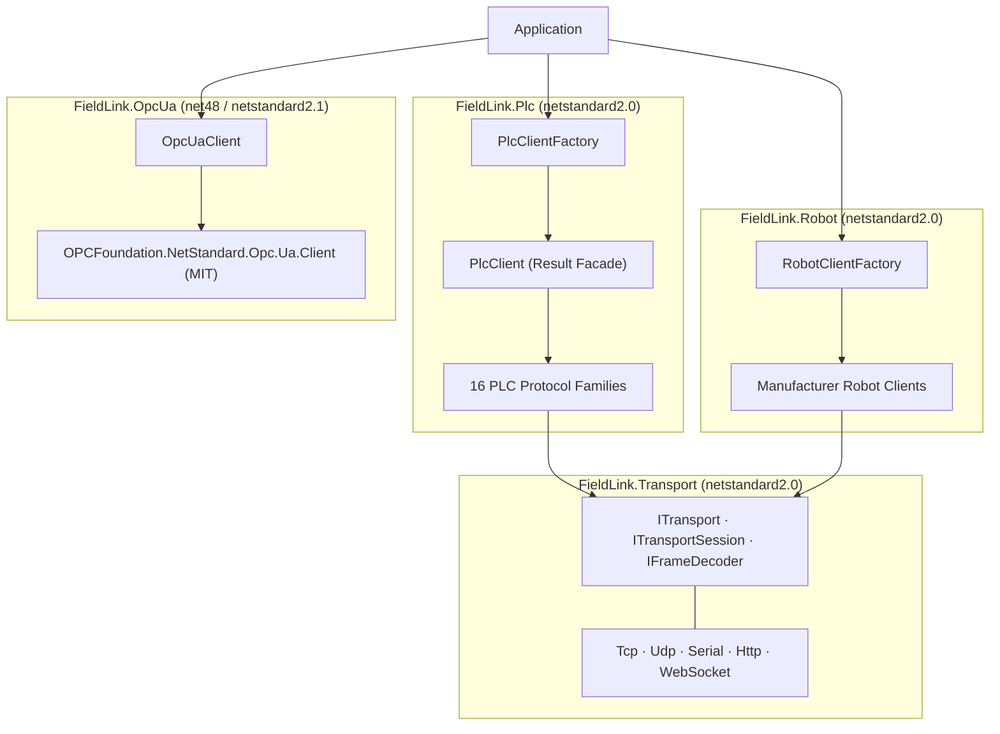

# FieldLink

**English** | [한국어](README.ko.md)

[](LICENSE)
[](Directory.Build.props)
[](src/FieldLink.OpcUa/FieldLink.OpcUa.csproj)
[](Directory.Build.props)

Industrial communication suite for .NET covering PLCs, industrial robots, and OPC UA servers through a shared transport abstraction and clean-room protocol implementations.

---

## Overview

FieldLink separates byte transport, wire protocol framing, and device data conversion into four modular packages:

| Package | Responsibility | Target Frameworks | Primary Entry Point |
| --- | --- | --- | --- |
| [`FieldLink.Transport`](src/FieldLink.Transport/FieldLink.Transport.csproj) | TCP, UDP, Serial (`System.IO.Ports`), HTTP, WebSocket, and `IFrameDecoder` framing | `netstandard2.0` | `ITransport`, `TcpTransport`, `SerialTransport` |
| [`FieldLink.Plc`](src/FieldLink.Plc/FieldLink.Plc.csproj) | 16 PLC protocol families with pure static builders, parsers, and address types | `netstandard2.0` | [`PlcClientFactory`](src/FieldLink.Plc/PlcClientFactory.cs), [`PlcClient`](src/FieldLink.Plc/PlcClient.cs) |
| [`FieldLink.Robot`](src/FieldLink.Robot/FieldLink.Robot.csproj) | Industrial robot controller clients across 8 manufacturers | `netstandard2.0` | [`RobotClientFactory`](src/FieldLink.Robot/RobotClientFactory.cs), [`IRobotClient`](src/FieldLink.Robot/Abstractions/IRobotClient.cs) |
| [`FieldLink.OpcUa`](src/FieldLink.OpcUa/FieldLink.OpcUa.csproj) | Isolated OPC UA client (`OPCFoundation.NetStandard.Opc.Ua.Client`, MIT) | `net48`, `netstandard2.1` | [`OpcUaClient`](src/FieldLink.OpcUa/OpcUaClient.cs), [`IOpcUaClient`](src/FieldLink.OpcUa/IOpcUaClient.cs) |

### Architecture



Design guarantees across the codebase:

- **Strict layer isolation**: `FieldLink.Transport` has zero knowledge of PLCs or robots. Protocol builders, parsers, and address types are stateless pure types tested without hardware.
- **Explicit error contract**: Caller mistakes (null inputs, malformed addresses, calls before `OpenAsync`) fail fast with standard .NET exceptions. Operational I/O and device rejections return `PlcResult` / `PlcResult<T>` or `RobotResult` / `RobotResult<T>` without hidden retries on writes.
- **OPC UA isolation**: `FieldLink.OpcUa` keeps the OPC Foundation dependency out of core transport, PLC, and robot assemblies. Security defaults to `MessageSecurityMode.SignAndEncrypt` without silent fallback to `None`.

---

## Supported Protocols

### PLC Protocols (`FieldLink.Plc`)

| Vendor / Standard | Series / Scope | Wire Protocol & Transport | `PlcClientFactory` Methods |
| --- | --- | --- | --- |
| **Modbus** | Standard compliant devices | Modbus TCP, Modbus RTU, Modbus ASCII | `CreateModbusTcp`, `CreateModbusRtu`, `CreateModbusAscii` |
| **Mitsubishi Electric** | MELSEC Q / L / iQ-R / iQ-F / FX | MC Protocol 3E Frame (Binary & ASCII) | `CreateMitsubishiMCBinary`, `CreateMitsubishiMCAscii` |
| **Siemens** | S7-200 / 300 / 400 / 1200 / 1500 | S7 communication over ISO-on-TCP (TPKT + COTP) | `CreateSiemensS7Comm` |
| **LS ELECTRIC** | XGT / XGB / XGK / XGI | FEnet dedicated Ethernet protocol | `CreateLsElectricFEnet` |
| **Delta Electronics** | DVP / AS Series | Modbus RTU / TCP with series address mapping | `CreateDelta`, `CreateDeltaDvpRtu`, `CreateDeltaDvpTcp`, `CreateDeltaAsTcp` |
| **FATEK** | FBs Series | FATEK Serial / TCP ASCII (`STX`/`ETX`/LRC) | `CreateFatek`, `CreateFatekSerial` |
| **Fuji Electric** | SPB Loader / MICREX-SX SPH | SPB ASCII (`:`/`CRLF`) & SPH SX-Bus binary (`0xFB`) | `CreateFujiElectricSpb`, `CreateFujiElectricSpbSerial`, `CreateFujiElectricSph`, `CreateFujiElectricSphTcp` |
| **GE Fanuc / Emerson** | PACSystems RX3i/RX7i, Series 90-30 | SRTP 56-byte binary header over TCP | `CreateGESrtp`, `CreateGESrtpTcp` |
| **Inovance** | AM400/600, H3U, H5U | Modbus RTU / TCP with series & bit-within-word mapping | `CreateInovance`, `CreateInovanceTcp`, `CreateInovanceRtu` |
| **JTEKT (Toyota)** | TOYOPUC (2PORT-EFR) | TOYOPUC Computer Link (Basic & Extended `PRG` banks) | `CreateJtektToyopuc`, `CreateJtektToyopucTcp` |
| **Keyence** | KV-8000 / 7000 / 5000 / 3000 / Nano | KV Host Link ASCII (`CR`/`RDS`/`WRS`/`CQ`) | `CreateKeyenceHostLink`, `CreateKeyenceHostLinkTcp`, `CreateKeyenceHostLinkSerial` |
| **Megmeet** | MC200 / MC280 Series | Modbus RTU / TCP with 16-bit/32-bit counter boundaries | `CreateMegmeet`, `CreateMegmeetRtu`, `CreateMegmeetTcp` |
| **Panasonic** | FP-X / FP0R / FP2SH / FP7 | MEWTOCOL-COM ASCII (`%`/`<` frames with BCC) | `CreatePanasonicMewtocol`, `CreatePanasonicMewtocolSerial`, `CreatePanasonicMewtocolTcp` |
| **VIGOR** | VS Series | Computer Link binary (`DLE STX ... DLE ETX` + sum check) | `CreateVigor`, `CreateVigorSerial` |
| **XINJE** | XC / XD · XL Series | Modbus RTU / TCP + extended function codes | `CreateXinje`, `CreateXinjeRtu`, `CreateXinjeTcp` |
| **Yokogawa** | FA-M3 Series | Higher-Level Link Service binary protocol | `CreateYokogawa`, `CreateYokogawaTcp` |

> Every factory method provides an `ITransport` overload for custom transports, logging wrappers, or deterministic unit tests.

### Industrial Robot Protocols (`FieldLink.Robot`)

| Manufacturer | Controller / Protocol | Transport | `RobotClientFactory` Methods |
| --- | --- | --- | --- |
| **ABB** | Robot Web Services (RWS) | HTTP / HTTPS | `CreateAbbRws` |
| **EFORT** | ER7B-C10 (V1 & V2 frames) | TCP | `CreateEfortER7BC10V1`, `CreateEfortER7BC10V2`, `CreateEfortER7BC10` |
| **Estun** | Estun Modbus interface | TCP | `CreateEstunModbus` |
| **FANUC** | FANUC Robot Interface | TCP | `CreateFanucRobotInterface` |
| **Hyundai Robotics** | Hi5/Hi6 OnLTrack | UDP listener | `CreateHyundaiOnLTrack` |
| **KUKA** | KUKA VarProxy | TCP | `CreateKukaVarProxy` |
| **KUKA** | KUKA Socket ASCII | TCP | `CreateKukaSocketAscii` |
| **Yamaha** | RCX Controller | TCP | `CreateYamahaRcx` |
| **Yaskawa** | YRC Ethernet | TCP | `CreateYaskawaYrcEthernet` |
| **Yaskawa** | High-Speed Ethernet Server (HSE) | UDP | `CreateYaskawaHighSpeedEthernet` |

### OPC UA Client (`FieldLink.OpcUa`)

`FieldLink.OpcUa` provides session lifecycle management (`OpenAsync`, `CloseAsync`), endpoint discovery, certificate store configuration, deadline enforcement, typed node read/write (`ReadValueAsync`, `ReadValuesAsync`, `WriteValueAsync`, `WriteValuesAsync`), address space browsing (`BrowseAsync`), monitored item subscriptions (`SubscribeAsync`), and method invocation (`CallAsync`). See [OpcUaClientOptions](src/FieldLink.OpcUa/OpcUaClientOptions.cs) and [IOpcUaClient](src/FieldLink.OpcUa/IOpcUaClient.cs) for configuration and security defaults.

---

## Quick Start

### PLC Read and Write (`FieldLink.Plc`)

```csharp
using System;
using System.Threading;
using System.Threading.Tasks;
using FieldLink.Plc;

using var client = PlcClientFactory.CreateMitsubishiMCBinary("192.168.0.10", port: 5000);

PlcResult openResult = await client.OpenAsync(CancellationToken.None);
if (!openResult.IsSuccess)
{
    Console.WriteLine($"Open failed: {openResult.Error.Message}");
    return;
}

PlcResult<int> counter = await client.ReadInt32Async("D100");
if (counter.IsSuccess)
{
    Console.WriteLine($"D100 = {counter.Value}");
}

PlcResult writeResult = await client.WriteInt16Async("D200", 1234);
if (!writeResult.IsSuccess)
{
    Console.WriteLine($"Write failed: {writeResult.Error.Message}");
}
```

### Industrial Robot Client (`FieldLink.Robot`)

```csharp
using System;
using System.Threading.Tasks;
using FieldLink.Robot;
using FieldLink.Robot.Abstractions;

using var robot = RobotClientFactory.CreateFanucRobotInterface("192.168.0.50");

RobotResult openResult = await robot.OpenAsync();
if (!openResult.IsSuccess)
{
    Console.WriteLine($"Robot open failed: {openResult.Error.Message}");
    return;
}

RobotResult<string> response = await robot.ReadStringAsync("snapshot");
if (response.IsSuccess)
{
    Console.WriteLine(response.Value);
}
```

### OPC UA Client (`FieldLink.OpcUa`)

```csharp
using System;
using System.Threading;
using System.Threading.Tasks;
using FieldLink.OpcUa;
using FieldLink.OpcUa.Security;
using Opc.Ua;

var options = new OpcUaClientOptions
{
    EndpointUrl = new Uri("opc.tcp://127.0.0.1:4840"),
    ApplicationName = "PlantClient",
    ApplicationUri = "urn:example:plant:client",
    MessageSecurityMode = MessageSecurityMode.SignAndEncrypt,
    UserIdentity = OpcUaUserIdentity.CreateAnonymous(),
    Certificates = new OpcUaCertificateOptions
    {
        StoreType = OpcUaCertificateStoreType.Directory,
        ApplicationCertificateStorePath = "pki/own",
        TrustedPeerCertificatesStorePath = "pki/trusted",
        TrustedIssuerCertificatesStorePath = "pki/issuer",
        RejectedCertificateStorePath = "pki/rejected"
    }
};

await using var opcClient = new OpcUaClient(options);
await opcClient.OpenAsync(CancellationToken.None);

DataValue value = await opcClient.ReadValueAsync(
    new ExpandedNodeId("TestRoot.Scalar.Int32", "urn:example:server"));
Console.WriteLine($"Value = {value.Value}, Status = {value.StatusCode}");
```

---

## Building and Testing

The repository uses a `.slnx` solution file, central package management ([Directory.Packages.props](Directory.Packages.props)), strict analyzer enforcement ([Directory.Build.props](Directory.Build.props)), and a unified `.editorconfig`.

```powershell
# Build all libraries, tests, and tools with warnings treated as errors
dotnet build FieldLink.slnx -c Release

# Run unit and loopback integration tests
dotnet test FieldLink.slnx -c Release

# Verify formatting rules
dotnet format FieldLink.slnx --verify-no-changes
```

> **Note**: Hardware tests tagged `[Trait("Category", "Hardware")]` require physical hardware and are excluded from CI runs. All unit and local loopback tests run without external devices.

---

## Repository Layout

```text
FieldLink/
├─ FieldLink.slnx
├─ Directory.Build.props          Shared build settings (Nullable, C# 12, warnings as errors)
├─ Directory.Packages.props       Central NuGet package versions
├─ LICENSE                        MIT License
├─ README.md                      English documentation
├─ README.ko.md                   Korean documentation
├─ THIRD-PARTY-NOTICES.md         Third-party license notices
├─ src/
│  ├─ FieldLink.Transport/        Core transport and framing abstractions
│  ├─ FieldLink.Plc/              PLC client facade and 16 protocol implementations
│  ├─ FieldLink.Robot/            Industrial robot controller protocols
│  ├─ FieldLink.OpcUa/            Isolated OPC UA client wrapper
│  └─ Shared/Polyfills/           Compiler polyfills for netstandard2.0
├─ tests/
│  ├─ FieldLink.Transport.Tests/
│  ├─ FieldLink.Plc.Tests/
│  ├─ FieldLink.Robot.Tests/
│  └─ FieldLink.OpcUa.Tests/
└─ tools/
   └─ FieldLink.PacketBench/      Benchmarking utilities
```

---

## Clean-Room Policy and License

FieldLink follows a **clean-room architecture**: PLC and robot wire codecs are derived from manufacturer manuals, public protocol standards, and verified hardware behavior without copying external driver implementations.

- **License**: [MIT License](LICENSE)
- **Third-Party Notices**: [THIRD-PARTY-NOTICES.md](THIRD-PARTY-NOTICES.md)
