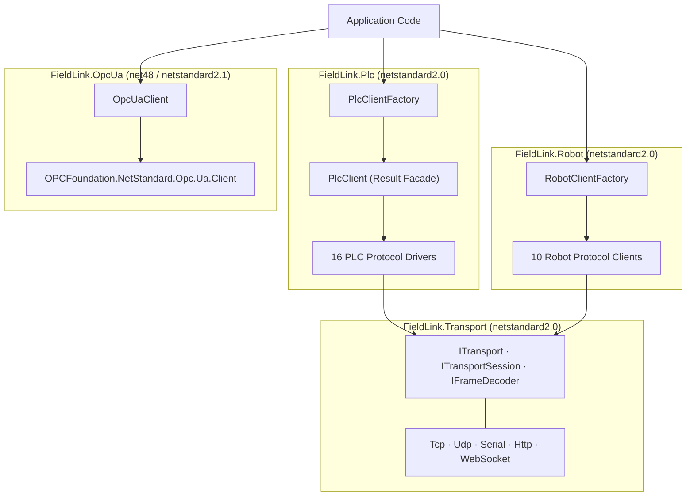

<div align="center">

# FieldLink

**Unified Industrial Communication Suite for .NET**  
PLC Protocols · Industrial Robots · OPC UA (IEC 62541) · Transport & Framing

**English** | [한국어](README.ko.md)

[](LICENSE)
[](Directory.Build.props)
[](src/FieldLink.OpcUa/FieldLink.OpcUa.csproj)
[](Directory.Build.props)

[Highlights](#highlights) · [Architecture](#architecture) · [Supported Protocols](#supported-protocols) · [Quick Start](#quick-start) · [Build & Test](#build-and-test) · [License](#license)

</div>

---

## Highlights

- **Strict Layer Separation**: [`FieldLink.Transport`](src/FieldLink.Transport/FieldLink.Transport.csproj) operates purely on byte streams, datagrams, and message frames with zero knowledge of PLC or robot semantics. Device packages communicate exclusively through transport contracts.
- **Stateless Wire Codecs**: Protocol `*Address`, `*RequestBuilder`, `*ResponseParser`, and `*FrameDecoder` types are stateless and hardware-independent, enabling deterministic frame-level verification without physical hardware.
- **Explicit Failure & Progress Contract**: Caller mistakes (null arguments, invalid addresses, calls before `OpenAsync`) fail fast with standard .NET exceptions. Operational I/O errors and device rejections return [`PlcResult`](src/FieldLink.Plc/PlcResult.cs) / `RobotResult`—tracking partial completion counts on multi-chunk writes and never retrying writes implicitly.
- **Isolated OPC UA Stack**: [`FieldLink.OpcUa`](src/FieldLink.OpcUa/FieldLink.OpcUa.csproj) isolates `OPCFoundation.NetStandard.Opc.Ua.Client` from core packages and enforces `MessageSecurityMode.SignAndEncrypt` by default without silent fallback to unencrypted connections.

---

## Architecture

| Package | Scope | Target Frameworks | Primary Entry Point |
| --- | --- | --- | --- |
| [`FieldLink.Transport`](src/FieldLink.Transport/FieldLink.Transport.csproj) | TCP, UDP, Serial (`System.IO.Ports`), HTTP, WebSocket, and `IFrameDecoder` codecs | `netstandard2.0` | [`ITransport`](src/FieldLink.Transport/ITransport.cs), `TcpTransport`, `SerialTransport` |
| [`FieldLink.Plc`](src/FieldLink.Plc/FieldLink.Plc.csproj) | 16 PLC protocol families with unified typed read/write facade | `netstandard2.0` | [`PlcClientFactory`](src/FieldLink.Plc/PlcClientFactory.cs), [`PlcClient`](src/FieldLink.Plc/PlcClient.cs) |
| [`FieldLink.Robot`](src/FieldLink.Robot/FieldLink.Robot.csproj) | Industrial robot controller protocols across 8 OEMs | `netstandard2.0` | [`RobotClientFactory`](src/FieldLink.Robot/RobotClientFactory.cs), [`IRobotClient`](src/FieldLink.Robot/Abstractions/IRobotClient.cs) |
| [`FieldLink.OpcUa`](src/FieldLink.OpcUa/FieldLink.OpcUa.csproj) | Security-enforced OPC UA (IEC 62541) client wrapper | `net48`, `netstandard2.1` | [`OpcUaClient`](src/FieldLink.OpcUa/OpcUaClient.cs), [`IOpcUaClient`](src/FieldLink.OpcUa/IOpcUaClient.cs) |



---

## Supported Protocols

### PLC Protocols (`FieldLink.Plc`)

Every factory method also provides an `ITransport` overload for custom transports, logging decorators, and unit testing.

| Vendor / Standard | Target Series | Wire Protocol & Framing | `PlcClientFactory` Entry Points |
| --- | --- | --- | --- |
| **Modbus** | Standard Modbus devices | Modbus TCP, Modbus RTU, Modbus ASCII | `CreateModbusTcp`, `CreateModbusRtu`, `CreateModbusAscii` |
| **Mitsubishi Electric** | MELSEC Q / L / iQ-R / iQ-F / FX | MC Protocol 3E Frame (Binary & ASCII) | `CreateMitsubishiMCBinary`, `CreateMitsubishiMCAscii` |
| **Siemens** | S7-200 / 300 / 400 / 1200 / 1500 | S7 communication over ISO-on-TCP (TPKT + COTP) | `CreateSiemensS7Comm` |
| **LS ELECTRIC** | XGT / XGB / XGK / XGI | FEnet dedicated Ethernet protocol | `CreateLsElectricFEnet` |
| **Delta Electronics** | DVP / AS Series | Modbus RTU / TCP with series address mapping | `CreateDelta`, `CreateDeltaDvpRtu`, `CreateDeltaDvpTcp`, `CreateDeltaAsTcp` |
| **FATEK** | FBs Series | FATEK Serial / TCP ASCII (`STX`/`ETX`/LRC) | `CreateFatek`, `CreateFatekSerial` |
| **Fuji Electric** | SPB Loader / MICREX-SX SPH | SPB ASCII (`:`/`CRLF`) & SPH SX-Bus binary (`0xFB`) | `CreateFujiElectricSpb`, `CreateFujiElectricSpbSerial`, `CreateFujiElectricSph`, `CreateFujiElectricSphTcp` |
| **GE Fanuc / Emerson** | PACSystems RX3i/RX7i, Series 90-30 | SRTP 56-byte binary protocol over TCP | `CreateGESrtp`, `CreateGESrtpTcp` |
| **Inovance** | AM400/600, H3U, H5U | Modbus RTU / TCP with series & bit-in-word mapping | `CreateInovance`, `CreateInovanceTcp`, `CreateInovanceRtu` |
| **JTEKT (Toyota)** | TOYOPUC (2PORT-EFR) | TOYOPUC Computer Link (Basic & Extended `PRG` banks) | `CreateJtektToyopuc`, `CreateJtektToyopucTcp` |
| **Keyence** | KV-8000 / 7000 / 5000 / 3000 / Nano | KV Host Link ASCII (`CR`/`RDS`/`WRS`/`CQ`) | `CreateKeyenceHostLink`, `CreateKeyenceHostLinkTcp`, `CreateKeyenceHostLinkSerial` |
| **Megmeet** | MC200 / MC280 Series | Modbus RTU / TCP with 16-bit/32-bit counter boundaries | `CreateMegmeet`, `CreateMegmeetRtu`, `CreateMegmeetTcp` |
| **Panasonic** | FP-X / FP0R / FP2SH / FP7 | MEWTOCOL-COM ASCII (`%`/`<` frames with BCC) | `CreatePanasonicMewtocol`, `CreatePanasonicMewtocolSerial`, `CreatePanasonicMewtocolTcp` |
| **VIGOR** | VS Series | Computer Link binary (`DLE STX ... DLE ETX` + sum check) | `CreateVigor`, `CreateVigorSerial` |
| **XINJE** | XC / XD · XL Series | Modbus RTU / TCP + extended function codes | `CreateXinje`, `CreateXinjeRtu`, `CreateXinjeTcp` |
| **Yokogawa** | FA-M3 Series | Higher-Level Link Service binary protocol | `CreateYokogawa`, `CreateYokogawaTcp` |

### Industrial Robot Protocols (`FieldLink.Robot`)

| Manufacturer | Controller / Protocol | Transport | `RobotClientFactory` Entry Points |
| --- | --- | --- | --- |
| **ABB** | Robot Web Services (RWS) | HTTP / HTTPS | `CreateAbbRws` |
| **EFORT** | ER7B-C10 (V1 & V2 frames) | TCP | `CreateEfortER7BC10V1`, `CreateEfortER7BC10V2`, `CreateEfortER7BC10` |
| **Estun** | Estun Modbus interface | TCP | `CreateEstunModbus` |
| **FANUC** | FANUC Robot Interface | TCP | `CreateFanucRobotInterface` |
| **Hyundai Robotics** | Hi5 / Hi6 OnLTrack | UDP listener | `CreateHyundaiOnLTrack` |
| **KUKA** | KUKA VarProxy | TCP | `CreateKukaVarProxy` |
| **KUKA** | KUKA Socket ASCII | TCP | `CreateKukaSocketAscii` |
| **Yamaha** | RCX Controller | TCP | `CreateYamahaRcx` |
| **Yaskawa** | YRC Ethernet | TCP | `CreateYaskawaYrcEthernet` |
| **Yaskawa** | High-Speed Ethernet Server (HSE) | UDP | `CreateYaskawaHighSpeedEthernet` |

### OPC UA Client (`FieldLink.OpcUa`)

`FieldLink.OpcUa` wraps session and channel internals while owning client lifecycle, security enforcement, and service contracts:

- **Lifecycle & Discovery**: Endpoint discovery (`OpcUaSdkDiscoveryClient`), strict X.509 certificate trust validation (untrusted certificates are never auto-accepted), domain validation (`checkDomain: true`), and generation-isolated sessions.
- **Data Access & Services**: Single and batch reads/writes (`ReadValueAsync`, `ReadValuesAsync`, `WriteValueAsync`, `WriteValuesAsync`), address space browsing (`BrowseAsync`), and method calls (`CallAsync`) with `OpcUaDeadline` timeout enforcement.
- **Subscriptions**: Bounded-queue subscriptions (`SubscribeAsync`) with explicit backpressure handling.

### Transport & Framing (`FieldLink.Transport`)

| Component | Implementations |
| --- | --- |
| **Stream & Packet Transports** | `TcpTransport`, `UdpTransport`, `UdpListenerTransport`, `SerialTransport`, `HttpTransport`, `WebSocketTransport` |
| **Frame Decoders (`IFrameDecoder`)** | `FixedLengthFrameDecoder`, `DelimitedFrameDecoder`, `HeaderLengthFrameDecoder`, `AvailableBytesFrameDecoder` |

---

## Quick Start

### 1. PLC Client (`FieldLink.Plc`)

```csharp
using System;
using System.Threading;
using System.Threading.Tasks;
using FieldLink.Plc;

using var client = PlcClientFactory.CreateMitsubishiMCBinary("192.168.0.10", port: 5000);

PlcResult openResult = await client.OpenAsync(CancellationToken.None);
if (!openResult.IsSuccess)
{
    Console.WriteLine($"Open failed: {openResult.Error.Message}");
    return;
}

PlcResult<int> counter = await client.ReadInt32Async("D100");
if (counter.IsSuccess)
{
    Console.WriteLine($"D100 = {counter.Value}");
}

PlcResult writeResult = await client.WriteInt16Async("D200", 1234);
if (!writeResult.IsSuccess)
{
    Console.WriteLine($"Write failed: {writeResult.Error.Message}");
}
```

### 2. Industrial Robot Client (`FieldLink.Robot`)

```csharp
using System;
using System.Threading.Tasks;
using FieldLink.Robot;
using FieldLink.Robot.Abstractions;

using var robot = RobotClientFactory.CreateFanucRobotInterface("192.168.0.50");

RobotResult openResult = await robot.OpenAsync();
if (!openResult.IsSuccess)
{
    Console.WriteLine($"Robot open failed: {openResult.Error.Message}");
    return;
}

RobotResult<string> snapshot = await robot.ReadStringAsync("snapshot");
if (snapshot.IsSuccess)
{
    Console.WriteLine(snapshot.Value);
}
```

### 3. OPC UA Client (`FieldLink.OpcUa`)

```csharp
using System;
using System.Threading;
using System.Threading.Tasks;
using FieldLink.OpcUa;
using FieldLink.OpcUa.Security;
using Opc.Ua;

var options = new OpcUaClientOptions
{
    EndpointUrl = new Uri("opc.tcp://127.0.0.1:4840"),
    ApplicationName = "PlantClient",
    ApplicationUri = "urn:example:plant:client",
    MessageSecurityMode = MessageSecurityMode.SignAndEncrypt,
    UserIdentity = OpcUaUserIdentity.CreateAnonymous(),
    Certificates = new OpcUaCertificateOptions
    {
        StoreType = OpcUaCertificateStoreType.Directory,
        ApplicationCertificateStorePath = "pki/own",
        TrustedPeerCertificatesStorePath = "pki/trusted",
        TrustedIssuerCertificatesStorePath = "pki/issuer",
        RejectedCertificateStorePath = "pki/rejected"
    }
};

await using var opcClient = new OpcUaClient(options);
await opcClient.OpenAsync(CancellationToken.None);

DataValue value = await opcClient.ReadValueAsync(
    new ExpandedNodeId("TestRoot.Scalar.Int32", "urn:example:server"));
Console.WriteLine($"Value = {value.Value}, Status = {value.StatusCode}");
```

---

## Build and Test

The solution uses [`FieldLink.slnx`](FieldLink.slnx), central NuGet package management ([`Directory.Packages.props`](Directory.Packages.props)), and strict build/style checks ([`Directory.Build.props`](Directory.Build.props) + [`.editorconfig`](.editorconfig)) with warnings treated as errors.

```powershell
# Build all libraries, tests, and tools
dotnet build FieldLink.slnx -c Release

# Run unit and local loopback test suites
dotnet test FieldLink.slnx -c Release

# Verify formatting rules
dotnet format FieldLink.slnx --verify-no-changes
```

| Test Project | Target Frameworks | Scope |
| --- | --- | --- |
| `FieldLink.Transport.Tests` | `net8.0` | Framing decoders, stream sessions, TCP/Serial lifecycle |
| `FieldLink.Plc.Tests` | `net8.0` | Address parsers, request builders, response parsers, multi-chunk protocol state |
| `FieldLink.Robot.Tests` | `net8.0` | Robot protocol codecs, HTTP/TCP/UDP drivers, session initialization |
| `FieldLink.OpcUa.Tests` | `net10.0`, `net48` | Loopback OPC UA server integration, security policy validation, subscriptions |

> Hardware integration tests tagged `[Trait("Category", "Hardware")]` require physical devices and are excluded from automated offline test runs.

---

## Repository Layout

```text
FieldLink/
├─ FieldLink.slnx                 Solution definition
├─ Directory.Build.props          Shared MSBuild properties (Nullable, C# 12, WarningsAsErrors)
├─ Directory.Packages.props       Centralized NuGet dependency versions
├─ .editorconfig                  Code style and analyzer enforcement
├─ LICENSE                        MIT License
├─ README.md                      English documentation
├─ README.ko.md                   Korean documentation
├─ THIRD-PARTY-NOTICES.md         Third-party license notices
├─ src/
│  ├─ FieldLink.Transport/        Transport channels and IFrameDecoder codecs
│  ├─ FieldLink.Plc/              PLC client facade and 16 protocol implementations
│  ├─ FieldLink.Robot/            Industrial robot protocol clients
│  ├─ FieldLink.OpcUa/            Isolated OPC UA (IEC 62541) client wrapper
│  └─ Shared/Polyfills/           Compiler feature polyfills for netstandard2.0
├─ tests/
│  ├─ FieldLink.Transport.Tests/
│  ├─ FieldLink.Plc.Tests/
│  ├─ FieldLink.Robot.Tests/
│  └─ FieldLink.OpcUa.Tests/
└─ tools/
   └─ FieldLink.PacketBench/      Packet throughput and allocation benchmark runner
```

---

## License

- **Project License**: [MIT License](LICENSE)
- **Third-Party Notices**: [THIRD-PARTY-NOTICES.md](THIRD-PARTY-NOTICES.md)
